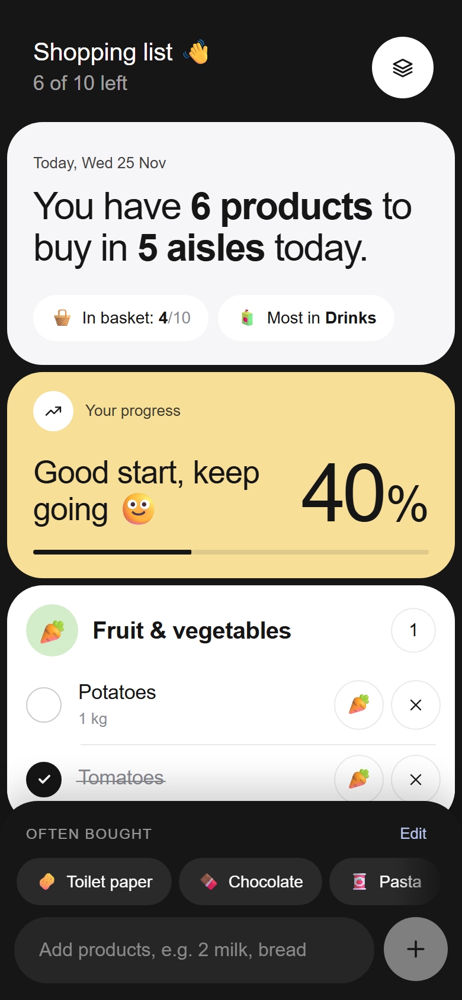
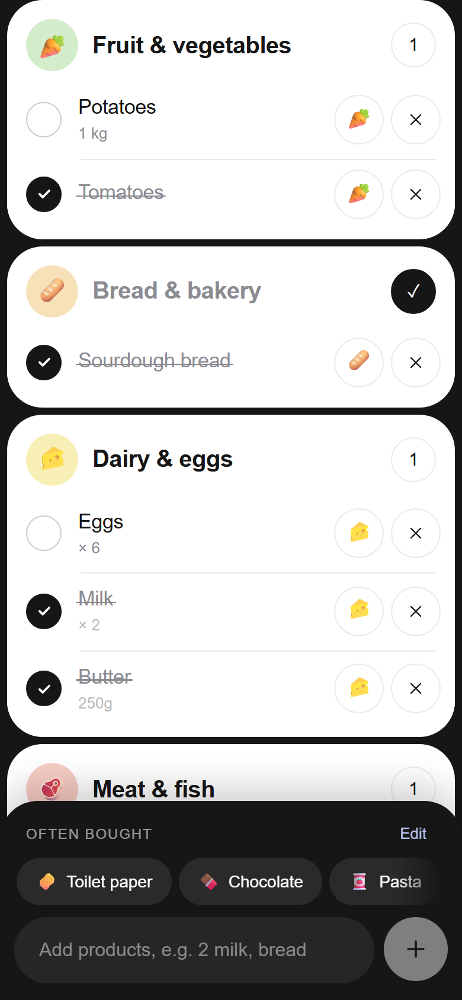
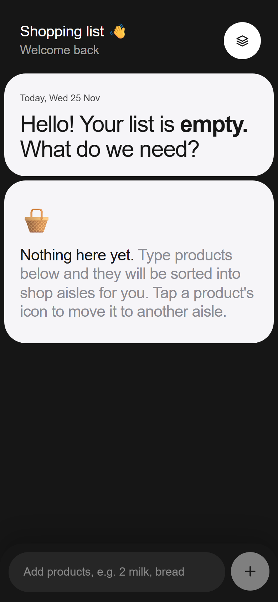
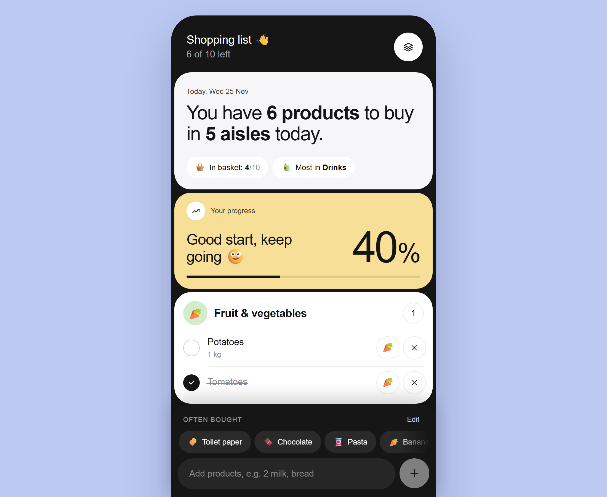

# Aisle — a shopping list that sorts itself

Type what you need, and the list arranges it in the order you walk through a shop: fruit & veg first, then bakery, dairy, meat, frozen, pantry, snacks, drinks and household. Tick things off as they go into the basket. Products you buy often come back as one-tap suggestions next time.

It's an installable PWA built with React and TypeScript. It works offline and keeps everything on your device: no account, no backend, no tracking.

**▶ Try it: [aisle-shopping-list.vercel.app](https://aisle-shopping-list.vercel.app/)**

<p align="center">
  
  &nbsp;
  
  &nbsp;
  
</p>

<p align="center">
  
</p>

## Features

- **Automatic aisle sorting.** 500+ English and Polish keywords. "Orange juice" goes to drinks, not fruit, and "chicken soup" goes to the pantry, not meat.
- **Quick typing.** Add several products at once with commas: `2 milk, bread, butter 250g, 1,5 l cola, 3x eggs`. Quantities are split off automatically, and decimal commas work.
- **It learns.** Move a product to another aisle once and it remembers that next time.
- **Suggestions.** Frequently bought products appear as chips. Typing filters them.
- **Undo everywhere.** Removing, clearing ticked items or clearing the whole list can be undone from a toast.
- **Careful motion.** Ticked items wait a moment, then glide to the bottom of their aisle, and the progress number counts up. Confetti plays when everything is in the basket. With *reduce motion* on, all of this becomes simple fades.
- **Offline and installable.** A service worker caches the app, so you can add it to your home screen or desktop.
- **Private.** Your list lives in your browser's `localStorage` and nothing leaves your device.

## Tech

React 19 · TypeScript · Vite · vite-plugin-pwa (Workbox) · plain CSS (no UI library, no web fonts)

```
src/
  lib/          parsing, aisle keywords + guessing, storage, motion helpers (FLIP, confetti)
  state/        useShoppingList: app state and actions
  components/   Header, Hero, ProgressCard, GroupCard, Dock, Toast
legacy/         the first version: a single dependency-free index.html
```

## Install it on your device

The app is live at **https://aisle-shopping-list.vercel.app/**. Open it once, add it to your device, and from then on it opens full-screen with its own icon, even without internet.

| Device | How |
| --- | --- |
| **iPhone / iPad** | Open the link in **Safari** → **Share** → **Add to Home Screen** |
| **Android** | Open the link in **Chrome** → menu **⋮** → **Install app** (or **Add to Home screen**) |
| **Desktop** | Open the link in **Chrome** or **Edge** → click the install icon at the right end of the address bar |

Your list is saved only on that device, in that browser.

New versions are published automatically on Vercel whenever `main` changes. An installed app picks up an update the next time it opens.

## Development

```bash
npm install
npm run dev       # development server
npm run build     # type-check + production build into dist/
```
